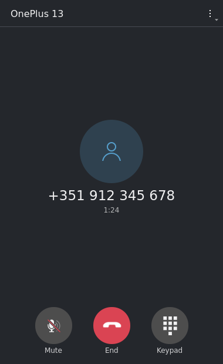
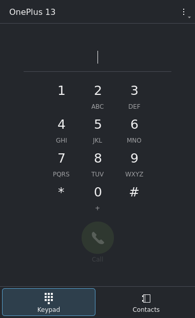
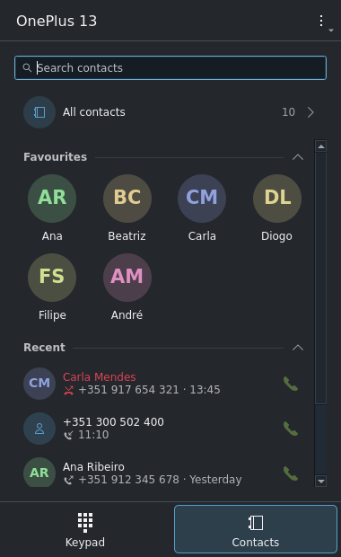

<p align="center">
  
</p>

<h1 align="center">Handset</h1>

<p align="center">Answer your phone calls on your PC.</p>

<p align="center">
  
  
  
  
</p>

I spend most of the day with a headset on, and my phone is usually across the room when it
rings. Handset makes the PC act like a car's hands-free kit: the phone stays where it is, the
call comes through on the computer, and I answer it with one click.

## Features

- Answer or decline from the notification, without opening the app
- Dial pad for outgoing calls
- Caller names, plus your phone's favourites, recent calls and contacts to call from, if the
  phone shares them (optional)
- Mute, keypad tones (for menus like "press 1 for…"), call waiting and hold
- Lives in the system tray and can start when you log in
- Connects for **calls only**, so your phone's music and videos keep playing on the phone

It works with any phone that supports Bluetooth hands-free, including Android phones and
iPhones. I use it with a OnePlus 13 on Bazzite (KDE Plasma).

## Requirements

- A Linux desktop with Bluetooth
- PipeWire **1.4 or newer** with WirePlumber. Most distributions from 2025 onwards have this
  (Fedora 42+, Bazzite, Ubuntu 25.10+, Arch, openSUSE Tumbleweed).
- Your phone paired with the PC in the system Bluetooth settings

Handset doesn't need KDE Connect or any app on the phone.

Mute requires PipeWire to expose `MicrophoneVolume` on its telephony audio gateway;
the upstream PipeWire 1.4 series does not expose this property. Calls still work,
but use the system sound controls to mute the microphone on those versions.

## Install

**From [FlatPark](https://flatpark.org/apps/io.github.kennyporto.Handset/)** (gets updates):

```sh
flatpak --user remote-add --if-not-exists flatpark https://dl.flatpark.org/flatpark.flatpakrepo
flatpak --user install flatpark io.github.kennyporto.Handset
```

**Single file:** download `Handset-<version>-x86_64.flatpak` from the
[latest release](https://github.com/KennyPorto/handset/releases/latest) and run
`flatpak install Handset-*.flatpak`. It doesn't update itself.

**Build it yourself:**

```sh
flatpak install flathub org.flatpak.Builder
flatpak run org.flatpak.Builder --user --install --install-deps-from=flathub \
    --force-clean build io.github.kennyporto.Handset.yml
flatpak run io.github.kennyporto.Handset
```

## Using it

1. Pair your phone in the Bluetooth settings, if you haven't already.
2. Open Handset. It connects to the phone on its own. If it doesn't, click **Connect Phone**.
3. Turn on **Start at Login** in the menu, so you never miss a call.

When a call comes in, a notification appears with **Answer** and **Decline**, and the
Handset window comes to the front. The call audio uses your default microphone and speakers
or headset, which you can change in the system sound settings at any time.

**Contacts are optional.** To see names instead of numbers, allow contact sharing for this
PC in the phone's Bluetooth settings (on Android: tap the gear next to the PC, then turn on
**Contact sharing**). The phone may ask for permission the first time. The **Contacts** tab
then shows your phone's favourites and recent calls, with the full list one click away under
**All contacts**. Handset fetches them each time the phone connects and after every call,
or when you click **Refresh Contacts** in the menu. Click the **Favourites** or **Recent**
heading to fold that section away.
Without them, everything else works the same and calls show the number.

Closing the window keeps Handset running in the tray. Use **Quit** in the menu to stop it.

## How it works

Handset doesn't talk to Bluetooth audio itself. PipeWire already implements the hands-free
profile (HFP), and since version 1.4 it publishes the phone's calls on D-Bus as
`org.pipewire.Telephony`, with the same interfaces as oFono. Handset:

- asks BlueZ to connect only the phone's hands-free profile
  (`0000111f-0000-1000-8000-00805f9b34fb`), not media audio (A2DP);
- watches `org.pipewire.Telephony` for calls and shows them;
- calls `Answer`, `Hangup`, `Dial`, `SendTones` and `HoldAndAnswer` on that service;
- shows desktop notifications with action buttons through `org.freedesktop.Notifications`;
- reads the phone's contacts over the phonebook profile (PBAP) through `obexd`
  (`org.bluez.obex`), if the phone allows it.

Call audio is a normal PipeWire device, so it follows your sound settings.

See [docs/ARCHITECTURE.md](docs/ARCHITECTURE.md) for the code layout.

## Troubleshooting

**"No phone connected" even though the phone is paired.**
Make sure Bluetooth is on and the phone is close. In the phone's Bluetooth settings, check
that **Phone calls** is allowed for this PC.

**The phone is connected but Handset doesn't see it.**
Check that PipeWire's telephony service is running:

```sh
busctl --user tree org.pipewire.Telephony
```

If that fails, your PipeWire is older than 1.4, or telephony is turned off. To turn it on,
create `~/.config/wireplumber/wireplumber.conf.d/50-telephony.conf`:

```
monitor.bluez.properties = {
  bluez5.telephony-dbus-service = true
  bluez5.telephony.provide-ofono = true
}
```

Then run `systemctl --user restart wireplumber`. If the oFono daemon (`ofonod`) is installed
and running, PipeWire hands calls to it instead, so stop it first.

**Music from my phone also plays on the PC.**
The phone connected its media audio to the PC by itself, or the desktop's Bluetooth menu did.
Handset never connects it, but it can't stop the phone from doing so. On the phone, open the
Bluetooth settings for this PC (on Android: the gear next to it) and turn off **Media audio**.
Calls and contacts keep working, and the phone's other sound stays on the phone, even after a
call or meeting ends.

**Contacts don't show up.**
Unlock the phone, check that **Contact sharing** is on for this PC, and click **Refresh
Contacts**. Some phones ask for permission in a notification the first time, and the request
times out if nobody accepts it.

**I can't hear the caller, or they can't hear me.**
Open the sound settings during a call and check that the right microphone and output are
selected.

## Privacy

Handset doesn't use the network. Caller numbers stay between your phone, your PC and the
notification on your screen, and calls aren't logged anywhere.

If you turn on contact sharing, Handset keeps a copy of the names and phone numbers (nothing
else), which ones are favourites, and the last 30 numbers you called or that called you, in `~/.var/app/io.github.kennyporto.Handset/cache/handset/contacts.json`, readable only
by you, so names show up even before the phone has synced. Turning off **Use Phone Contacts**
in the menu deletes it and stops Handset from fetching contacts.

## Development

```sh
git clone https://github.com/KennyPorto/handset
cd handset
python3 -m venv .venv
.venv/bin/pip install -e . pytest
.venv/bin/pytest
```

The interface uses KDE's Kirigami, which isn't on PyPI, so run the app through the Flatpak
(see **Install**) or install Kirigami from your distribution and run `python3 -m handset`.

Bug reports and pull requests are welcome. Please read [CONTRIBUTING.md](CONTRIBUTING.md)
first.

If Handset is useful to you, a like or a review on AlternativeTo helps other people find it.

<a href="https://alternativeto.net/software/handset/about/"><picture>
  <source media="(prefers-color-scheme: dark)" srcset="https://alternativeto.net/static/badges/badge-compact-dark.svg">
  
</picture></a>

## License

[MIT](LICENSE) © 2026 KennyPorto
